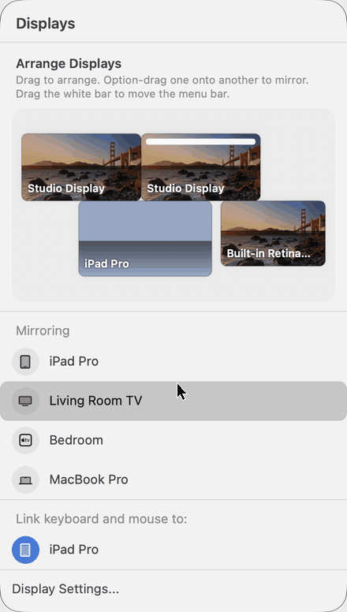
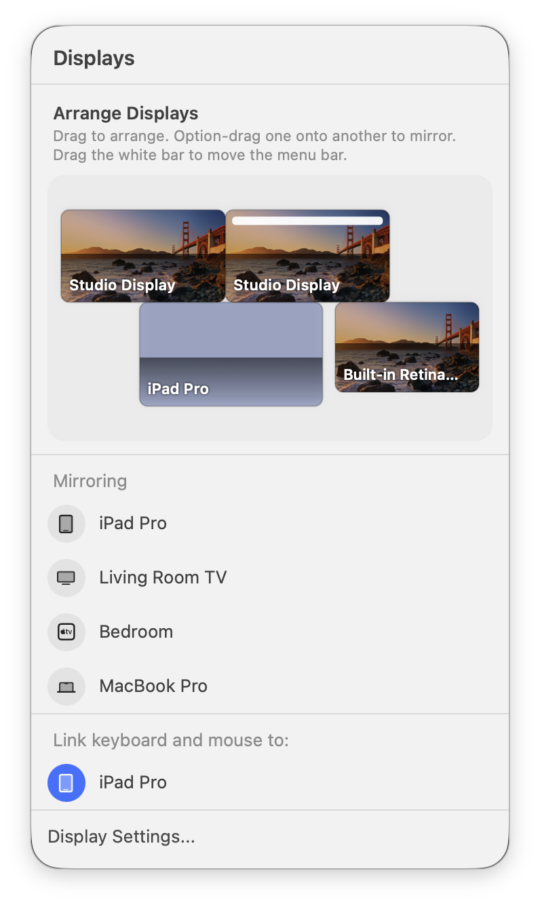
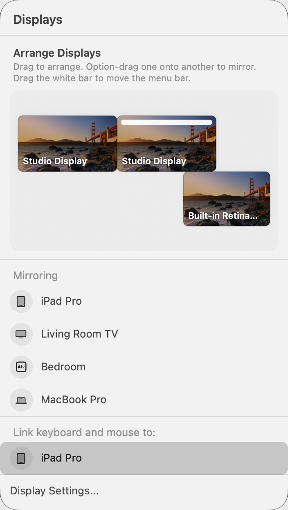

# Arrange

A menu-bar panel for macOS that puts **System Settings › Displays › Arrange** and the
**Control Center display menu** in one place, and **moves a Universal Control iPad from
its own canvas**.



| linked | unlinked |
|---|---|
|  |  |

## What it does

- **Arrange real displays.** Drag to rearrange, Option-drag onto another display to mirror,
  drag the white bar to move the menu bar. It applies through CoreGraphics and sticks.
- **Move the Universal Control iPad.** A linked iPad shows in the canvas at its real
  position. Dropping it moves the live UC edge, not a preview.
- **Link keyboard and mouse.** The list matches System Settings. Click a device to link it,
  click again to unlink. Blue means System Settings shows it as linked.
- **Sidecar.** Clicking a nearby iPad under Mirroring starts Sidecar, and clicking it again stops it.
- **AirPlay receivers** are listed via Bonjour. Starting AirPlay mirroring to them is **not
  implemented**. A click just beeps.

## How the Universal Control parts work

Apple keeps UC configuration behind a private entitlement
(`com.apple.universalcontrol`). An ordinary app gets `-71168 missing entitlement` from
every UC write path. Arrange does not try to get around that. It drives the
**System Settings** UI that does hold the entitlement, through Accessibility:

1. It opens Displays settings in the background and parks the window under a
   click-through "Moving iPad…" cover.
2. **Linking:** it presses the Displays "+" menu and picks the device under *Link keyboard
   and mouse to*. The menu's check mark is the source of truth for the blue row.
3. **Moving:** it opens the Arrange sheet and repeats your drag, scaled, on the iPad tile.
   The sheet ignores mouse events under any window, so the cover leaves a small hole over
   the drag path. The cursor makes one quick trip there and is put back.
4. It presses Done, quits Settings if it opened it, and returns focus to your app.

Expect System Settings to flash briefly in the Dock and the cursor to jump for about a
second during a move.

## Requirements and limits — read before using

- **Apple silicon (arm64) only.** `Sources/uc_self.S` holds arm64 trampolines into Swift
  methods of the private `UniversalControl.framework`.
- **Built and tested on macOS 27.2 (26B123).** Reading UC edges uses private Swift symbols
  whose names and calling conventions can change with any macOS update. If they are missing,
  the iPad tile and the blue linked state won't appear. Arranging physical displays still works.
- **English system language.** It finds controls in System Settings by their English labels
  ("Arrange…", "Done", "Link keyboard and mouse to").
- **Accessibility permission** is required for every Universal Control feature
  (System Settings › Privacy & Security › Accessibility).
- **Not notarized.** Build it yourself (below). An ad-hoc signed app loses its Accessibility
  grant on every rebuild, so set `ARRANGE_SIGN_IDENTITY` to a code-signing identity you own
  to keep it.
- Placement precision is about ±1–2 canvas points. The Arrange sheet snaps.
- One linked iPad at a time.

## Build and run

```bash
./build.sh                                   # ad-hoc signed
ARRANGE_SIGN_IDENTITY="Your Identity" ./build.sh   # keeps the Accessibility grant across rebuilds
open Arrange.app                             # menu-bar icon: a monitor over a rounded square
ARRANGE_SHOW=1 Arrange.app/Contents/MacOS/Arrange   # opens the panel on launch
Arrange.app/Contents/MacOS/Arrange --self-test       # layout + parser checks, exit 0 = pass
```

Needs the Xcode command-line tools (`swiftc`, `clang`). No packages.

### Screenshot labels

`ARRANGE_LABELS="Real Name=Shown Name|Other=Shown"` relabels devices **on screen only**, so
you can share screenshots without exposing device names. Matching and linking still use
the real names.

## Files

- `Sources/Layout.swift` — snapping and settling for the canvas
- `Sources/Services.swift` — Bonjour browsing, Sidecar, CoreGraphics apply, reading UC edges
- `Sources/Arranger.swift` — the System Settings driver (cover, link menu, Arrange sheet)
- `Sources/Panel.swift` — the panel, canvas, and rows
- `Sources/uc_self.S` — arm64 Swift method trampolines
